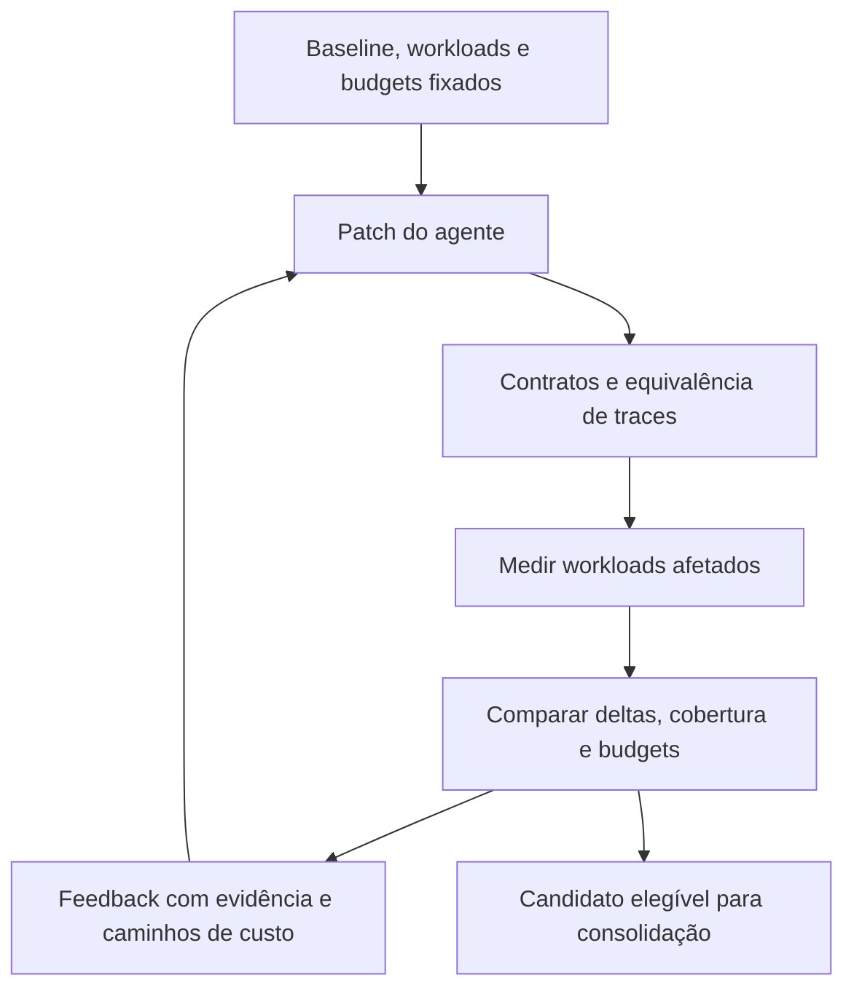

# Mapas de recursos e quality gates para loops de agentes

Data: 2026-10-05. Pesquisa solicitada por Pedro; proposta de suporte a S7.
Estado: **PROPOSTA**, com um piloto host já retido e adoção de ferramenta
externa **UNKNOWN**. Este relatório não institui um novo gate obrigatório.

## Recomendação

**Usar infraestrutura existente de benchmarks/profiling e construir uma camada
pequena de harness específica do projeto.** Avaliar CodSpeed primeiro, por
reunir comparação de runs, perfis consultáveis por agentes e checks de regressão.
Bencher é uma alternativa para histórico e gates sobre métricas que nossos
instrumentos já produzam. A escolha depende do experimento abaixo; nenhuma
dessas ferramentas foi instalada ou avaliada neste projeto nesta pesquisa.

A oportunidade própria está em ligar contratos, workloads, equivalência de
traces, budgets e feedback ao agente. Construir também um profiler, armazenamento
histórico e motor estatístico aumentaria o trabalho antes de demonstrar benefício.
Uma ferramenta independente só merece nova avaliação se essa camada revelar
necessidades recorrentes que as ferramentas existentes não atendam, inclusive
em outros projetos. **INFERENCE:** esse é o investimento proporcional à evidência
disponível hoje, não uma conclusão de custo obtida por benchmark de integração.

Rotas locais: [piloto host](../evidence/runtime-cost-20261005/result.json),
[auditoria de tipos/contratos](../evidence/types-contracts-health-20261005.json),
[progresso](../../plans/PROGRESS.md), [caminho S1–S7](../../plans/ROADMAP.md)
e [limites de execução Android](ANDROID-EXECUTION-DECISION-LIMITS-20261005.md).

## A ideia e o que ela compra

A proposta de Pedro é manter um mapa de tipos/contratos, tempo e memória;
medir novamente após uma mudança; e devolver ao agente a pergunta concreta:
**“Esse delta de recursos era esperado e justificável?”** A consolidação
dependeria da verificação desse delta e da preservação do comportamento exigido.

**INFERENCE:** isso pode comprar detecção precoce de regressões, orientação
para otimizações com impacto no caminho inteiro, tradeoffs explícitos e evidência
comparável entre iterações. Um agente pode descobrir que uma abstração correta
duplicou trabalho, ou que mais paralelismo quase não aumentou a capacidade e
elevou muito a memória. O mapa ajuda a escolher a próxima hipótese; o gate
impede consolidar uma mudança que ultrapassa o orçamento definido.

O benefício real ainda exige medir falsos alertas, regressões escapadas, tempo
do loop e qualidade das correções. Um gate caro ou ruidoso pode piorar esse
loop. Registrar métricas, sozinho, não demonstra aumento de produtividade.

## O que deve ser uma entrada do mapa

Uma função não tem um custo único independente de entrada, estado e chamador.
A unidade proposta é **função × contexto de chamada × workload**, com cobertura
declarada. Funções e caminhos não exercitados ficam `UNKNOWN`, nunca custo zero.

| Parte | Conteúdo necessário |
|---|---|
| Identidade | Símbolo/localização, hash do código/modelo, baseline e candidato |
| Contrato | Entradas/saídas, unidades, limites, erros, efeitos e invariantes de imutabilidade |
| Workload | Cenário, seeds, tamanho/estado da entrada, repetição e bloco de validação separado |
| Contexto | Hardware, SO, runtime, instrumento e configuração |
| Tempo | Número de chamadas quando medido, tempo próprio e inclusivo, distribuição e máximo observado |
| Memória | Bytes alocados, retenção e pico, apenas no escopo efetivamente observado pelo instrumento |
| Relações | Dependências estáticas e chamadas observadas, com threads/processos e fronteiras assíncronas |
| Evidência | Instrumento, resultados brutos referenciados, limitações, cobertura e teto da afirmação |

O tempo inclusivo de um pai contém o de seus filhos: somar ambos duplica o custo.
Em concorrência, a duração do caminho crítico depende das precedências e
esperas; somar CPU das threads não reconstrói a latência fim a fim. Clusters
devem partir de caminhos observados e responsabilidades, não apenas de funções
com nomes parecidos. O custo medido do caminho é o critério de impacto.

**Limites do mapa:** p99 e máximo observado não provam WCET. RSS de processo
não é pico de alocação de cada função. Bytes alocados ao longo da execução não
são bytes simultaneamente vivos. Uma amostra de heap de objetos vivos pode
omitir temporários já liberados. Tipos estáticos também não demonstram que um
payload externo foi validado em runtime. Cada métrica precisa conservar sua
semântica ao trocar instrumento ou backend.

## Ferramentas e precedentes encontrados

`VERIFIED` abaixo significa que a fonte primária foi consultada, não que
reproduzimos o produto ou seu resultado. Ganhos externos são relatos dos autores
ou fornecedores, com seus domínios e critérios. Fontes consultadas em 2026-10-05.

### CodSpeed: mapa operacional, comparação e feedback ao agente

**VERIFIED:** o MCP oferece resultados estruturados, comparações de runs com
diferenças de ambiente e benchmarks ausentes/novos, além de consulta a
flamegraphs com tempo próprio/inclusivo e filtros por thread ou raiz. É uma
interface já existente para devolver evidência ao agente.
[Documentação do MCP](https://codspeed.io/docs/ai/mcp).

**VERIFIED:** checks podem bloquear merge por regressão contra a branch
principal. Existe reconhecimento explícito de regressões; em repositórios de
organizações, a documentação reserva essa ação a administradores. Essa
capacidade não estabelece nossos contratos ou budgets automaticamente.
[Performance checks](https://codspeed.io/docs/features/performance-checks).

**VERIFIED:** o instrumento de memória usa eBPF e hooks de alocadores; apresenta
stacks, timeline, pico alocado e pico físico/RSS. Há requisitos de framework e
limitações de captura, incluindo casos envolvendo processos filhos e alocadores
estáticos. **INFERENCE:** precisamos testar a atribuição no V8; hooks de
`malloc`/`free` não demonstram, por si, o pico de cada função ou objeto JavaScript.
[Instrumento de memória](https://codspeed.io/docs/instruments/memory).

**VERIFIED:** a integração Node oferece plugins para Vitest, Tinybench,
benchmark.js e Playwright. A matriz consultada lista Node 22/24 com plugins
`>=6.0.0`; Node 23, usado no diagnóstico local anterior, não aparece nela.
O piloto externo deve fixar um runtime suportado e produzir nova baseline.
[Suporte Node](https://codspeed.io/docs/benchmarks/nodejs/overview).

**INFERENCE:** é o candidato inicial mais próximo do mapa operacional mais gate
mais interface ao agente. Não encontramos nessas fontes uma certificação
automática de todos os contratos, todos os piores casos ou fidelidade device-side.

### Bencher e alternativas com escopo menor

**VERIFIED:** Bencher documenta histórico de benchmarks, thresholds estatísticos,
comparações relativas e `--error-on-alert`; pode consumir resultados em formato
JSON. Sua detecção de mudança sobre histórico é posterior, e não substitui o
check antes do merge. **INFERENCE:** é uma boa alternativa quando quisermos
preservar nossos instrumentos e exportar suas métricas; o mapa semântico e o
feedback de diagnóstico continuam sob nossa responsabilidade.
[Comparação e gates no Bencher](https://bencher.dev/docs/how-to/track-benchmarks/).

**VERIFIED:** `github-action-benchmark` mantém resultados e pode falhar por
regressão. Serve como opção mais simples de histórico/gate, sem prometer o mapa
completo proposto.
[Repositório e documentação](https://github.com/benchmark-action/github-action-benchmark).

**VERIFIED:** aiT integra análise estática de WCET ao Jenkins, com condições de
falha e relatórios arquivados. É um precedente do mapa mais gate em sistemas
embarcados; sua aplicabilidade depende do alvo e modelo de hardware suportados.
Não equivale a provar WCET de uma aplicação Node arbitrária.
[Integração aiT/Jenkins](https://www.absint.com/ait/jenkins.htm).

### Ganhos palpáveis em harnesses de otimização

**VERIFIED — resultado relatado pelos autores:** o preprint PerfAgent descreve
refinamento iterativo com resumo de profiler, testes selecionados e retenção da
melhor mudança correta. Com GPT-5.1, a taxa de patches que alcançam o critério
de desempenho do especialista, ajustada por hacks, passa de 19,6% a 39,2% em
GSO e de 26% a 74% em SWE-efficiency-Lite. **Essas taxas não são speedups do
projeto inteiro.** Um caso NumPy chega a 5,87x ao mudar a implementação para
um kernel nativo. O estudo também discute otimizações aparentes por caching
de resultados do benchmark. Não foi reproduzido aqui e não prova cobertura
universal de memória ou contratos.
[PerfAgent, versão 1](https://arxiv.org/html/2607.19653v1).

**VERIFIED — resultado relatado pelo fornecedor:** DeepMind descreve AlphaEvolve
como geração de programas com avaliadores automáticos e seleção evolutiva.
Relata recuperação média de 0,7% da capacidade computacional mundial do Google
com uma heurística de scheduling em produção, e um kernel 23% mais rápido que
reduziu em 1% o tempo de treinamento do Gemini. São exemplos de ganhos com
avaliação objetiva em domínios específicos, não uma ferramenta que mapeia
automaticamente todo este repositório. Não foram verificados independentemente
nesta pesquisa.
[Relato primário do AlphaEvolve](https://deepmind.google/blog/alphaevolve-a-gemini-powered-coding-agent-for-designing-advanced-algorithms/).

**INFERENCE:** esses precedentes sustentam experimentar feedback medido no
loop. Não sustentam prometer determinado ganho para o FNaF, nem construir toda
a infraestrutura antes de testar a integração.

## Evidência local e o que ela ainda não prova

O resultado gerado
[`runtime-cost-ea4b967107908ae7`](../evidence/runtime-cost-20261005/result.json)
retém cenários, hashes de fontes/modelo, contexto e controles. Seu teto é
**MODEL_ONLY**, medido no host registrado, sem qualificação de execução no phone.

| Observação retida | Interpretação permitida |
|---|---|
| Cópias/clonagem: 77,5% do tempo amostrado do loop | Priorizar a investigação desse caminho; não equivale a 77,5% dos bytes, de todo o projeto ou de trabalho eliminável |
| Cópias no caminho `observe → update → reduceBelief`: 47,95% do total amostrado | Investigar custo acumulado de atualizar crença por fato observado |
| Variante sem históricos: redução observada de 6,2%, com instrumentação também alterada | Efeito causal **INCONCLUSIVE**; requer comparação isolada |
| Replay de 512 seeds: 4 workers, 2,56x; 6 workers, 2,63x frente ao serial | Nesse bloco com hashing de snapshots, 6 workers pouco aumentaram throughput |
| RSS de 322,4 para 476,9 MiB entre 4 e 6 workers | O pequeno ganho veio com cerca de 48% mais pico de memória do processo |

As cópias preservam contratos de estado. **Hipótese aberta:** fazer uma cópia
privada por lote de observações, ou compartilhar estruturas imutáveis não
alteradas, pode reduzir esse custo. Nenhuma dessas mudanças foi implementada
ou validada por este relatório; traces e invariantes precisam decidir a
equivalência. Reescrever em Rust ou mudar a representação de uma run exige a
mesma prova, além da nova medição.

O comparador experimental `tools/resource-delta.ts` já tem controles
retidos: [no-op passa](../evidence/runtime-cost-20261005/noop.json)
(`resource-delta-372dd63217dacc53`),
[execução redundante mais buffer de 64 MiB pede revisão](../evidence/runtime-cost-20261005/regression.json)
(`resource-delta-6a88853ff6061cb6`) e
[justificativa com orçamento ainda recusa um excesso](../evidence/runtime-cost-20261005/expected.json)
(`resource-delta-8d325510215fb530`). No controle plantado, o aumento de tempo é
detectado; a atribuição do aumento de RSS permanece `INCONCLUSIVE` sob a
dispersão observada.

Esse piloto exige contexto/cobertura compatíveis e budgets finitos. Sua tolerância
experimental de 20% e suas faixas empíricas não são política geral, intervalos
de confiança ou prova de WCET. Ele valida a estrutura da justificativa, não o
benefício alegado nem a autoridade de quem definiu o budget. Ainda não mede um
mapa completo nem executa automaticamente o loop de agentes.

Os resultados do comparador são retidos neste registro. Sua implementação,
o instrumento `packages/propose/bin/census/runtime-cost.ts` e a integração
`test:resources` permanecem alterações de trabalho pendentes de um commit
próprio; não são ferramentas disponíveis em um checkout deste commit de pesquisa.

A [auditoria de contratos](../evidence/types-contracts-health-20261005.json)
(`types-contracts-health-0a796b4b289be972`, **FIXTURE**) registra ratchets
estáticos passando e contraexemplos em validação runtime de regiões/perfis.
Logo, o mapa deve declarar contratos verificados e fronteiras abertas;
anotações de tipos não bastam para autorizar uma otimização.

## Harness proposto

O diagrama é uma proposta: falhas de contrato impedem a elegibilidade, e a
comparação só libera candidatos dentro das condições de aceitação. Medir um
candidato incorreto pode ajudar o diagnóstico, mas não o torna elegível.

| Responsabilidade | Onde deve viver |
|---|---|
| Instrumentação CPU/heap, perfis, histórico e análise de regressões | Ferramentas existentes, após validar cobertura |
| Workloads, caminhos relevantes, contratos, fidelidade e teto de evidência | Instrumentos e registros deste projeto |
| Executar checks, ligar IDs, selecionar feedback e controlar iterações | Camada própria pequena, compondo as rotas existentes |
| Propor patch e explicar tradeoff com benefício verificável | Agente |
| Decidir resultado usando baseline/budgets fixados | Verificador fora do patch candidato |

A baseline, os casos de aceitação e a autoridade para alterar budgets precisam
ficar fora da mudança que está sendo julgada. O agente pode propor outro budget,
mas não aprová-lo como parte do próprio patch. Uma frase justificando consumo
nunca transforma um estouro em aprovação. Mudança de cobertura, dados ausentes
ou ambientes incompatíveis devem produzir `UNKNOWN`/revisão, sem aparência de
melhoria. Para preservar tradeoffs, retenção de candidatos pode manter opções
com combinações diferentes de tempo/memória dentro dos limites estabelecidos.

Em cada iteração, rodar contratos/traces selecionados e workloads afetados;
aprofundar profiling quando o delta ou a hipótese exigir. Antes da consolidação,
ampliar a validação para cenários independentes e gates exigidos. **INFERENCE:**
essa divisão pode preservar velocidade do loop, sem medir todas as funções
do repositório a cada edição. A seleção precisa declarar cobertura e ser testada
contra regressões fora do caminho inicialmente suspeito.

O feedback deve identificar baseline/candidato, hashes, contexto, métrica e
escopo, dispersão, status, budget, evidência e hipótese seguinte. Deve ligar o
delta à função/caminho observado quando houver atribuição confiável; onde só
existe RSS de processo, conservar esse escopo. Resultado ausente não pode ser
preenchido com inferência do agente.

## Experimento que decide adoção — ainda não executado

1. Fixar um pequeno conjunto de workloads relevantes do simulador/controller,
   contratos e traces esperados; reservar casos independentes e adversariais.
2. Medir baseline e candidato no mesmo host/runtime suportado, alternando
   execuções para reduzir efeitos de deriva. Definir repetições, aquecimento,
   estado frio/quente, thresholds e budgets antes de examinar o candidato.
3. Executar controles: nenhuma mudança, trabalho redundante, buffer tocado e
   retido, alteração indevida de trace e redução indevida da cobertura.
4. Comparar o instrumento local com CodSpeed sobre os mesmos workloads. Avaliar
   Bencher se histórico/métricas próprias forem a necessidade predominante.
   Não transportar números absolutos da baseline macOS/Node 23 para Linux/Node 22.
5. Tentar uma otimização real do caminho de cópias com equivalência verificada.
   Verificar se o feedback localiza o custo e melhora a próxima iteração.
6. Testar caching ilegítimo do resultado e crescimento das entradas. Medir tanto
   a execução inicial quanto o regime pertinente ao uso real, preservando os
   contratos; um benchmark repetido não deve aceitar reutilização proibida.
7. Reter falsos alertas, controles escapados, custo/latência de medição, esforço
   de integração e resultados das correções. Decidir pelos dados obtidos.

**Critério proposto:** adotar infraestrutura existente se detectar os controles,
preservar a semântica das métricas e oferecer feedback útil com custo tolerável
ao loop. Escrever adaptadores somente para lacunas demonstradas. Reconsiderar
uma ferramenta própria completa se limitações concretas impedirem esse resultado
e forem recorrentes o suficiente para justificar mantê-la.

Os limites numéricos aceitáveis, o número necessário de repetições e a cobertura
real de alocações JS continuam **UNKNOWN** até calibrar esse experimento.

## Continuação device-side

Sem device, podemos validar o harness host e os contratos de representação.
Deadlines e picos do phone continuam **UNKNOWN**: métricas host não promovem
uma afirmação a `DEVICE_MEASURED`.

Com o device disponível, os workloads devem representar captura, decode,
observação, decisão, scheduling e confirmação de aceitação no alvo, além de
seus custos próprios. Medir também o caminho completo e cargas sustentadas,
retendo condições térmicas e concorrência pertinentes. Qualificar instrumentos
e permissões antes de interpretar a cobertura. O acesso segue perfil resolvido
e hash, preflight, lease exclusiva, comandos/deadlines limitados, telemetria e
liberação segura da [política de device](../operations/DEVICE-SAFETY.md).

A [pesquisa Android complementar](ANDROID-EXECUTION-DECISION-LIMITS-20261005.md)
detalha o experimento de placement/latência. Este relatório não escolhe um
backend, não toca o phone e não fecha S4.

## Hipóteses e estado

| Hipótese | Estado em 2026-10-05 | O que falta |
|---|---|---|
| Um delta gate distingue no-op de uma grande regressão host | Sustentada nos controles limitados do piloto **MODEL_ONLY** | Sensibilidade a regressões menores, ruído e workloads independentes |
| O mapa aponta um caminho de cópias com custo relevante | Sustentada pela amostra host registrada | Otimização equivalente e efeito causal medido |
| Contratos estáticos bastam para fidelidade | Refutada como critério suficiente pelos contraexemplos **FIXTURE** | Cobertura de validação runtime e traces |
| Feedback medido melhora o loop dos agentes neste projeto | **UNKNOWN**; precedentes externos favoráveis | Comparação local do loop e custo total |
| CodSpeed substitui grande parte da infraestrutura de medição | **INFERENCE** a partir de capacidades documentadas | Piloto real, cobertura V8, ambiente e integração |
| Já podemos impor budgets de device | **UNKNOWN**, sem medição do alvo | Instrumentação e evidência no phone |

Este documento preserva a proposta, os precedentes e o experimento de decisão.
A evidência local citada mantém seus IDs e limites originais. Não há nova
medição de performance, mudança de política ou qualificação de device decorrente
da escrita deste relatório.
